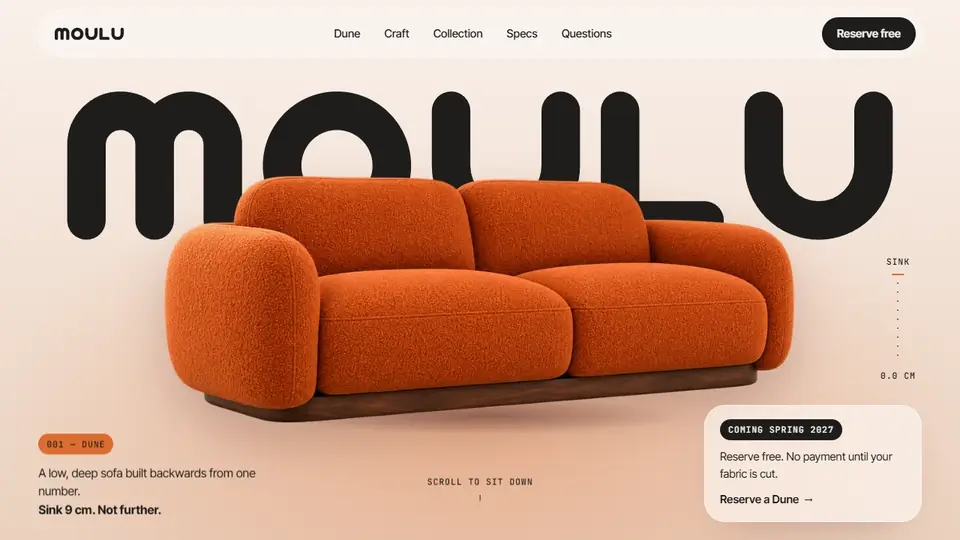

<a href="https://moulu.vercel.app/"></a>

<p align="center"><kbd>001 — DUNE</kbd> &nbsp; <kbd>SINK 9.0 CM</kbd> &nbsp; <kbd>SPRING 2027</kbd></p>

<h2 align="center">Furniture you sink into, slowly.</h2>

<p align="center">
A launch site for a sofa that doesn't exist yet.<br>
Built backwards from one number: nine centimetres.
</p>

<p align="center">
<a href="https://moulu.vercel.app/"><picture><source media="(prefers-color-scheme: dark)" srcset=".github/assets/btn-visit-light.png"></picture></a>
</p>

<br>

|  |  |
|---|---|
| **Scroll once.** | The sofa sits down. The letters make room. |
| **Keep going.** | 121 frames. Turn it around before you buy. |
| **Pick a fabric.** | Ember, Chalk, Cocoa. The whole page follows. |
| **Save your seat.** | Free. Nothing leaves your browser. |

<br>

```bash
cd site && npm install && npm run dev
```

<sub>Vite · TypeScript · GSAP · Lenis &nbsp;—&nbsp; 0 cookies · 0 trackers · 100 accessibility &nbsp;—&nbsp; notes in <a href="docs/BRAND.md">brand</a> · <a href="docs/DESIGN.md">design</a> · <a href="docs/PROGRESS.md">progress</a></sub><br>
<sub>Moulu is fictional. Imagery is AI-generated. Code is <a href="LICENSE">MIT</a>. Built for the long sit.</sub>
