<a href="https://moulu.vercel.app/">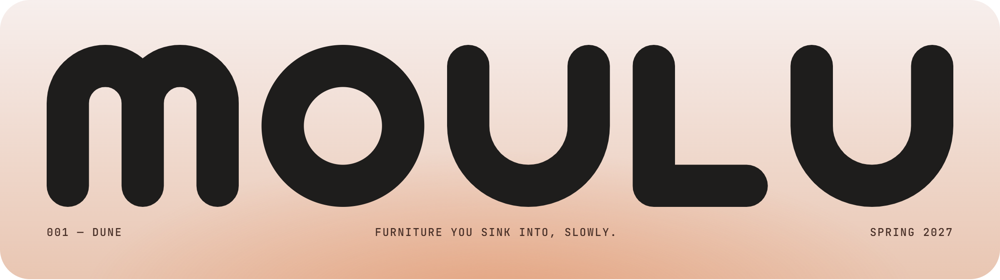</a>

<h3 align="center">Sink 9 cm. Not further.</h3>

<p align="center">
A launch site for a sofa that doesn't exist yet,<br>
built around one measured feeling: <b>the nine-centimetre sink.</b>
</p>

<p align="center">
<a href="https://moulu.vercel.app/"></a>
</p>

<a href="https://moulu.vercel.app/">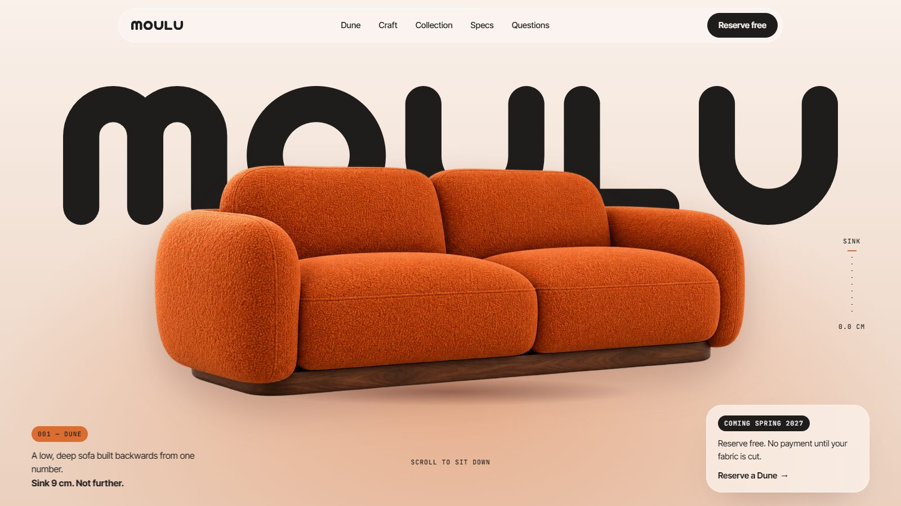</a>

<p align="center"><sub>Scroll once, and the sofa sits down. The letters make room. The ruler counts to 9.0.</sub></p>

<br>

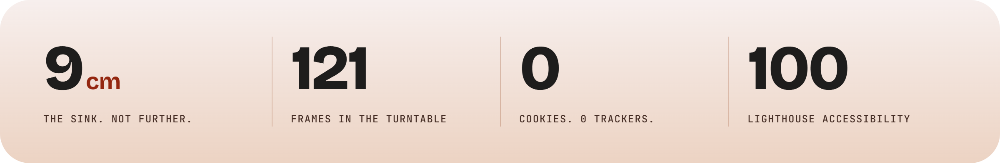

<br>


## Four things to try on the site

| | |
|---|---|
| **1 · The Sink** <br> Scroll the hero. The sofa settles 9 cm, the wordmark parts around it, a ruler measures it. The brand promise, acted out. | **2 · Turn it around** <br> 121 frames, scrubbed by your scroll on a canvas. Check the back and the arm profile before you reserve. |
| 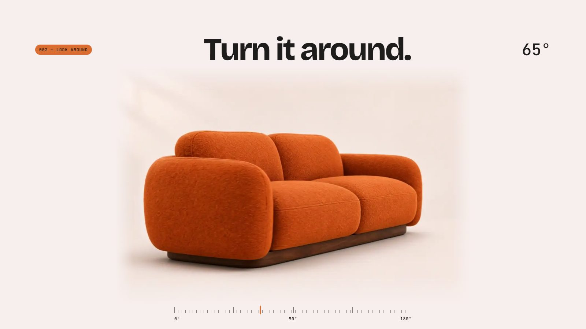 | 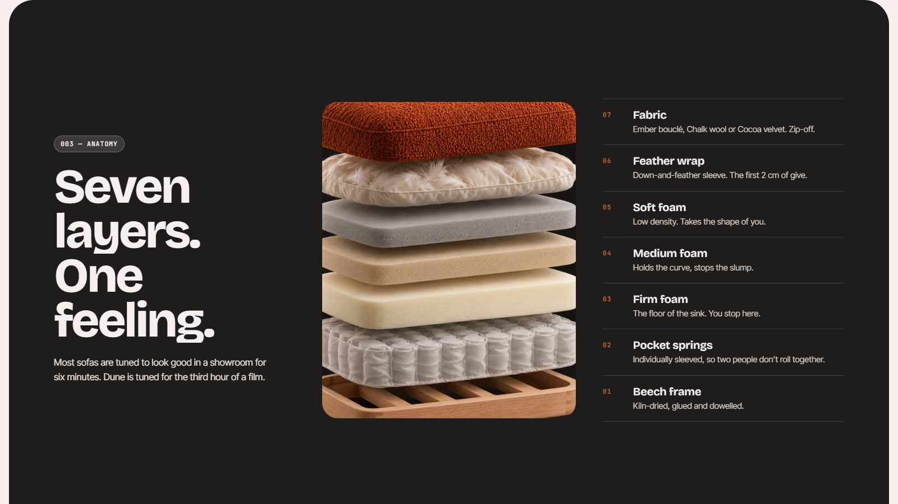 |
| **3 · Seven layers** <br> Beech frame, pocket springs, three foams, feather wrap, fabric. Tuned for the third hour of a film, not six minutes in a showroom. | **4 · Choose a mood** <br> Three fabrics. Pick one and the whole page recolours, not just the sofa. |

<table>
<tr>
<td width="33%">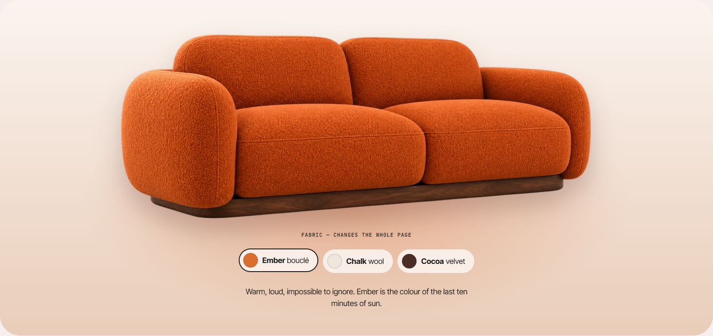<p align="center"><sub><b>Ember</b> bouclé — the last ten minutes of sun</sub></p></td>
<td width="33%">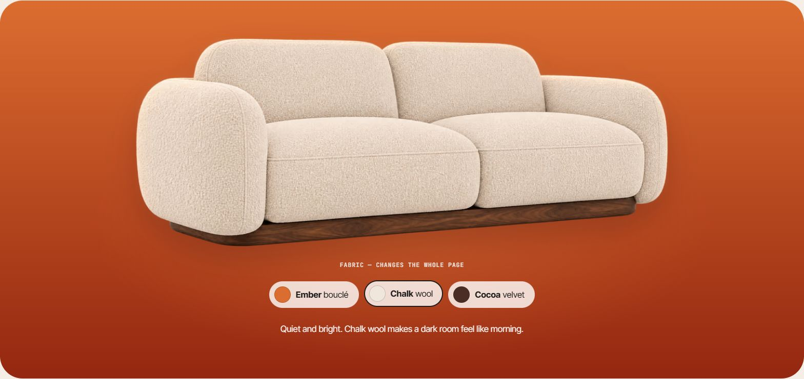<p align="center"><sub><b>Chalk</b> wool — a dark room that feels like morning</sub></p></td>
<td width="33%">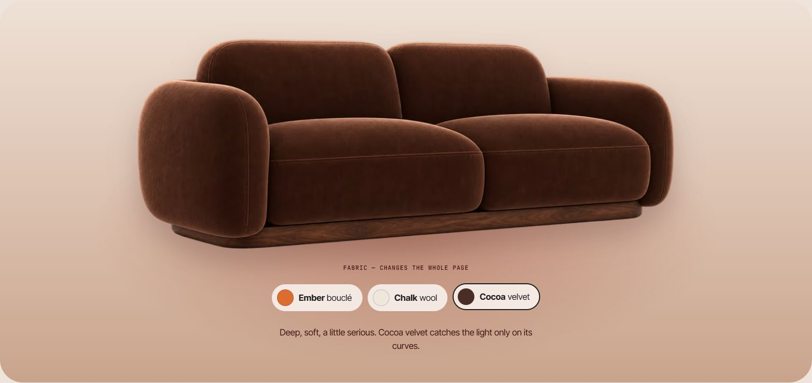<p align="center"><sub><b>Cocoa</b> velvet — light only on the curves</sub></p></td>
</tr>
</table>

<table>
<tr>
<td width="68%">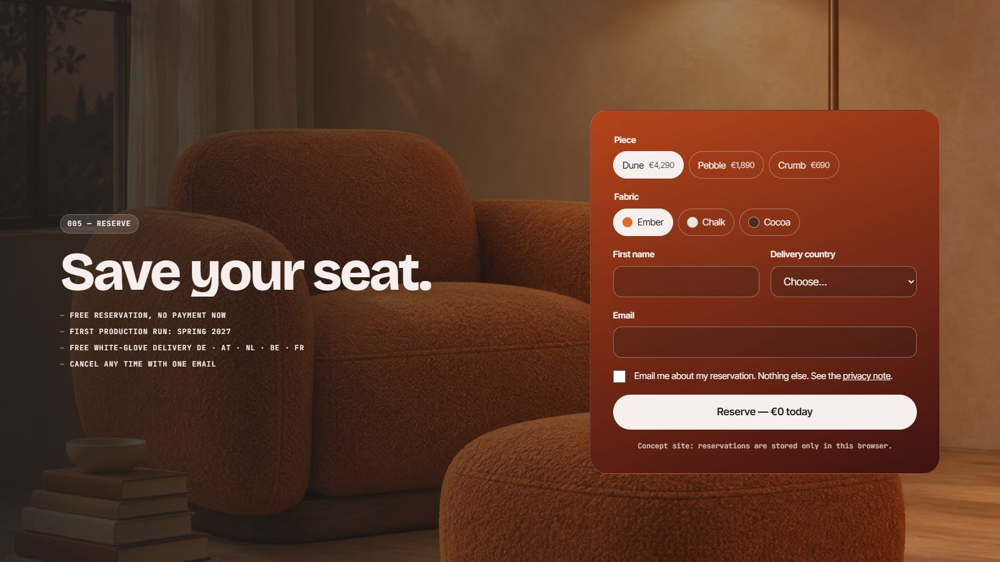</td>
<td width="32%">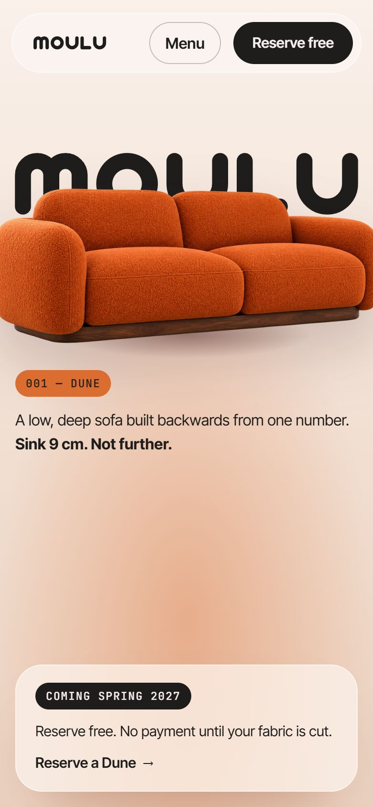</td>
</tr>
<tr>
<td><sub><b>Save your seat.</b> Free reservation, no payment. Stored only in your browser.</sub></td>
<td><sub>Same sink on a phone.</sub></td>
</tr>
</table>

<p align="center">
<a href="https://moulu.vercel.app/#reserve">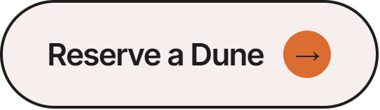</a>
</p>

<br>


## Under the hood

Built for feel first, then speed. No framework, no cookie banner, nothing that waits for you.

| | |
|---|---|
| **Stack** | Vite · TypeScript · GSAP (ScrollTrigger, SplitText) · Lenis |
| **Motion** | One shared 1.4 s intro timeline. Every scroll scene is built behind the loader, so nothing stalls mid-animation. 0 frames over 33 ms while scrolling. |
| **Turntable** | 121 WebP frames fetched as blobs and decoded off the main thread (`createImageBitmap`). 2.8 MB desktop, 1.3 MB mobile. |
| **Privacy** | Fonts self-hosted. 0 cookies, 0 trackers, 0 third-party requests. |
| **Access** | Works without JS. `prefers-reduced-motion` gets everything, minus the motion. The turntable becomes a slider. |
| **Lighthouse** | 95–98 performance · 100 accessibility · 100 best practices · 100 SEO |
| **Browsers** | Chrome, Firefox, WebKit (Safari engine) |

<br>


## Sit down locally

```bash
cd site
npm install
npm run dev      # http://localhost:5173
npm run build    # → site/dist
```

Every push to `main` deploys to [moulu.vercel.app](https://moulu.vercel.app/) (Vercel, root `site/`).

```
moulu/
├── site/                 the website
│   ├── index.html        landing page (all content in HTML, works without JS)
│   ├── privacy.html      "Nothing to keep."
│   ├── imprint.html      "Who is behind the sofa."
│   ├── src/modules/      hero · turntable · mood · motion · form · specs
│   └── public/media/     optimised AVIF/WebP, video, turntable frames
├── docs/
│   ├── BRAND.md          name, voice, products, story
│   ├── DESIGN.md         type, colour, motion language, section plan
│   ├── PROGRESS.md       every pass, fix and score
│   ├── ANALYSIS.md       reference-site study
│   ├── CREDITS.md        AI image/video credit ledger
│   ├── HANDOFF.md        start here if you continue the work
│   └── research/         QA captures, Lighthouse reports, references
└── .github/assets/       README art
```

Read in this order: [BRAND](docs/BRAND.md) → [DESIGN](docs/DESIGN.md) → [PROGRESS](docs/PROGRESS.md).

<br>


## Fine print

- **Moulu is fictional.** The brand, the products, the prices and the company details are a concept. Nothing ships and no payment is ever taken.
- The sofa imagery and turntable footage are AI-generated (Higgsfield), from one master sofa image so every view matches.
- Reservations stay in your browser's `localStorage`. The Privacy page lets you delete them.
- Code: [MIT](LICENSE). Name, wordmark and imagery: for viewing this project only.

<br>

<p align="center">
<a href="https://moulu.vercel.app/"></a>
<br><br>
<sub>Built for the long sit.</sub>
</p>
